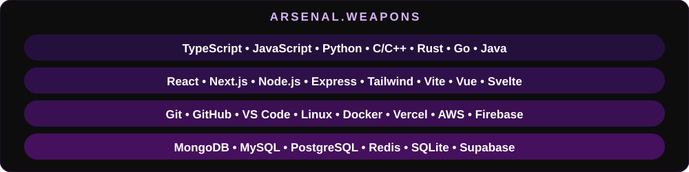
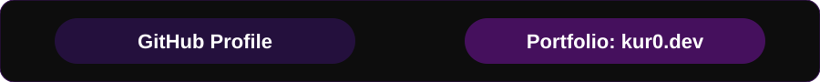
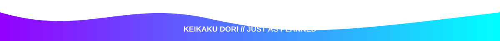

  

<h2 align="center">ARSENAL.WEAPONS</h2>

  

<h2 align="center">CERTIFICATIONS</h2>

  

<h2 align="center">SNAKE.hunt</h2>

  <picture>
    <source media="(prefers-color-scheme: dark)" srcset="https://raw.githubusercontent.com/KUR00000/KUR00000/output/github-contribution-grid-snake-dark.svg"/>
    <source media="(prefers-color-scheme: light)" srcset="https://raw.githubusercontent.com/KUR00000/KUR00000/output/github-contribution-grid-snake.svg"/>
    
  </picture>

  

  <a href="https://github.com/KUR00000">GitHub</a>
  &nbsp;·&nbsp;
  <a href="https://kur0.dev">Portfolio</a>

  

